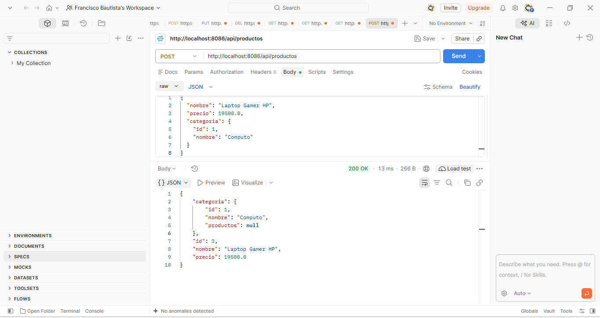
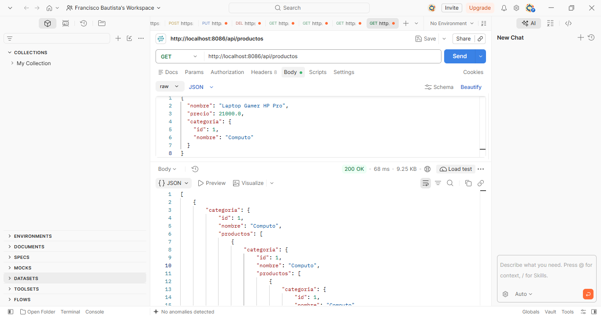
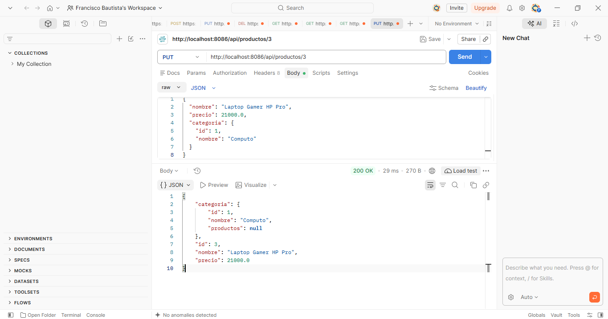
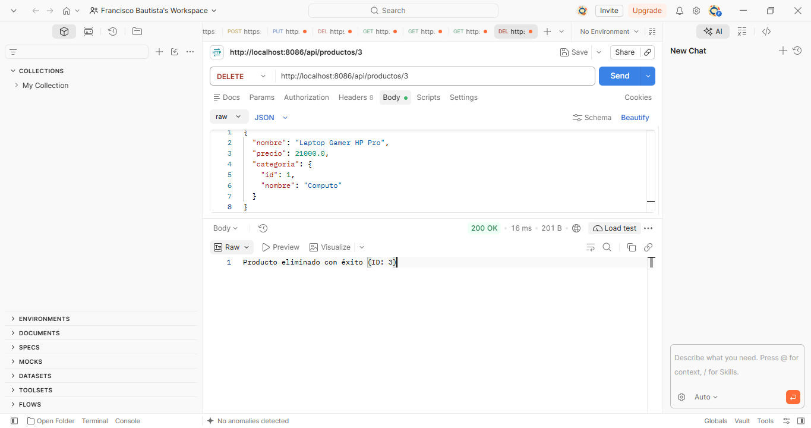

# Actividad 3 - CRUD en Spring Boot y Relaciones JPA 

## Datos Generales
* **Nombre:** Francisco Elías Bautista Centeno
* **Carrera:** Ingeniería en Sistemas (7to Semestre)
* **Institución:** Instituto Tecnológico de Oaxaca
* **Docente:** Adelina Martínez Nieto
* **Tecnologías utilizadas:** Spring Boot, Spring Data JPA, MySQL, Java 21, Lombok, Postman.

---

## 1. Estructura del Proyecto y Arquitectura
El proyecto implementa una arquitectura en capas (`Controller`, `Service`, `Repository`, `Model`) conectada a una base de datos relacional MySQL (`tienda_db`), cumpliendo con el principio de separación de responsabilidades.

### Entidades Relacionadas (`@ManyToOne` / `@OneToMany`)
* **Categoría (`Categoria.java`):** Entidad principal que actúa como tabla padre con una relación de uno a muchos hacia los productos.
* **Producto (`Producto.java`):** Entidad dependiente que contiene una llave foránea (`categoria_id`) mediante la anotación `@ManyToOne`.

---

## 2. Pruebas del CRUD (Postman)

A continuación se documentan las operaciones del CRUD realizadas y probadas localmente y en el VPS:

### Crear Registro (POST)
* **Endpoint:** `POST /api/productos`
* **Descripción:** Permite registrar un nuevo producto asociado a una categoría existente.

### Consultar Registros (GET)
* **Endpoint:** `GET /api/productos`
* **Descripción:** Retorna la lista completa de productos en formato JSON, reflejando correctamente el objeto de la categoría relacionada.

### Actualizar Registro (PUT)
* **Endpoint:** `PUT /api/productos/{id}`
* **Descripción:** Modifica los atributos de un producto existente (nombre, precio o categoría).

### Eliminar Registro (DELETE)
* **Endpoint:** `DELETE /api/productos/{id}`
* **Descripción:** Elimina un producto específico de la base de datos a través de su identificador.

---

---

## 4. Despliegue en el VPS (Vultr)
* **Servidor:** VPS Linux (Vultr)
* **IP del servidor:** `216.238.69.86`
* **Puerto de ejecución:** `8084`
* **Enlace de acceso a la API:** `http://216.238.69.86:8086/api/productos`

---
